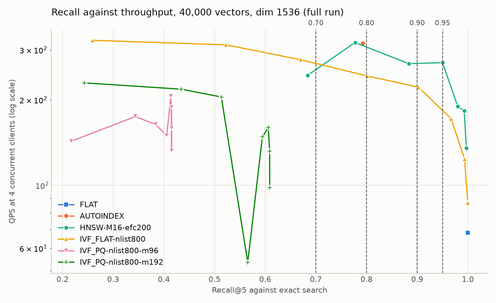

> **Refactor notice (2026-11-04):** This project was renamed from Retail RAG to Restaurant RAG. Unlike the other previous docs, this one is kept current and uses the new names, because its results are still to be written into it ([ADR A7](../2-rename-retail-to-restaurant/adr-rename_retail_to_restaurant.md#a7-keep-previous-docs-word-for-word-and-add-a-notice)). See also the [migration plan](../2-rename-retail-to-restaurant/migration_plan-rename_retail_to_restaurant.md).

# Benchmark — Milvus Index Types

> ## 📍 Scope
> | | |
> |---|---|
> | **Question** | Which index should `wongnai_review_coll` use, given accuracy, latency, throughput, build time and memory? |
> | **Under test** | **HNSW**, **IVF_FLAT**, **IVF_PQ**, with **FLAT** as the exact baseline and **AUTOINDEX** as what is deployed today |
> | **Harness** | [`notebook/benchmark_index_types.ipynb`](../../../notebook/benchmark_index_types.ipynb) |
> | **Results go to** | MLflow experiment `restaurant_rag/phase_1_index_types` at `http://localhost:5000`, plus `data/eval/runs/index-types-<mode>-<UTC>/` |
> | **Related** | [`benchmark.md`](../benchmark.md) records the deployed configuration. This doc compares alternatives. It is not a Part 1 exit criterion, and [`DEV_PLAN.restaurant.md`](../../../DEV_PLAN.restaurant.md) does not call for it |

**Written:** 2026-11-03 (Asia/Bangkok, UTC+7)
**Updated:** 2026-11-06 — full run results in §6, with the recall-against-QPS chart in §6.5; recommendation added as §9, so the run log is now §10; §7 and §8 updated from the run; moved into `docs/part_1/3-benchmark_index_types/`, beside a new note on how memory is measured. 2026-11-05 — new names after the rename; the deployed index and row count are settled; the run now guards against the PC sleeping; smoke run output added. 2026-11-04 — all queries now come from held-out reviews: recall on 6,195, latency and QPS on a fixed sample of 1,000; RAM repeated over 3 restarts and re-read after the sweep; margin of error added; head-to-head at four recall targets (0.70, 0.80, 0.90, 0.95)
**Author:** claude-opus-5-5 (Claude Code)
**Status:** ✅ **Full run done.** The 2026-11-05 full run completed and logged to MLflow. Results are in [§6](#6-results) and the recommendation in [§9](#9-recommendation). Production is unchanged until the owner approves a switch

---

## How to read this file

Every result cell is one of:

| Mark | Meaning |
|---|---|
| 🔲 | Not measured yet |
| ✅ | Measured, reached the recall target |
| ⚠️ | Measured, did not reach the target, or the run needs a caveat — see notes |
| ➖ | Not applicable |

**Do not fill a cell from an estimate.** Build parameters and sweep ranges below are starting values chosen before any measurement, not findings. Only a `MODE = "full"` run fills the results tables; smoke runs prove the harness and nothing else.

---

## Table of Contents

1. [Summary](#1-summary)
2. [What was found before running anything](#2-what-was-found-before-running-anything)
3. [Method](#3-method)
4. [What is under test](#4-what-is-under-test)
5. [MLflow record](#5-mlflow-record)
6. [Results](#6-results)
7. [How to run](#7-how-to-run)
8. [Known limits](#8-known-limits)
9. [Recommendation](#9-recommendation)
10. [Run log](#10-run-log)

---

## 1. Summary

| | |
|---|---|
| **Status** | ✅ Full run done on 2026-11-05 ([§6.6](#66-environment-of-the-run)) |
| **Results** | [§6](#6-results) |
| **Recommendation** | [§9](#9-recommendation), after the method and limits it depends on |

---

## 2. What was found before running anything

Five facts from the code, the stack and the rename work change how this benchmark has to work.

**The deployed index is `AUTOINDEX`, not an explicit HNSW.** [`milvus_service.create_collection()`](../../../app/services/milvus_service.py) passes no index parameters, so pymilvus's quick-setup path requests `index_type="AUTOINDEX"`. The [migration baseline](../2-rename-retail-to-restaurant/migration_plan-rename_retail_to_restaurant.md#phase-0-prepare) confirmed this on the live collection on 2026-11-04: `AUTOINDEX` with `IP`, all 40,000 rows indexed. From memory, open-source Milvus usually resolves that to HNSW with parameters of its own choosing, but this is unverified. So AUTOINDEX is measured as its own config, and the notebook records the deployed index from `describe_index`, which also answers the open index cells in [`benchmark.md` §1.2 and §4](../benchmark.md#12-disk-footprint-40000-vectors-in-milvus).

**The Milvus that produced the existing numbers is v2.5.10.** It comes from `k:\MLOps\data_server` (`milvus/Dockerfile`), not this repo's `docker-compose.yml`, which pins v2.4.0. The client is pymilvus 2.6.9, newer than the server. The rename rehearsal created an `AUTOINDEX` index across that gap, but the smoke run is the first test of explicit `HNSW`, `IVF_FLAT` and `IVF_PQ` indexes.

**The collection holds 40,000 rows.** The saved output of `data_server_info.ipynb` says 39,360, but `count(*)` at Strong consistency returned 40,000 on 2026-11-04, including 640 rows with `id >= 39360`, so the ingest was complete ([H8](../2-rename-retail-to-restaurant/migration_plan-rename_retail_to_restaurant.md#hazards)). The notebook still counts with `count(*)` and stops if the answer is not 40,000.

**MLflow and Milvus share one MinIO.** Uploading artifacts during a timed window would load the storage Milvus uses. So measuring and logging are separate steps: nothing is logged until all measuring is finished.

**Milvus exits if the PC sleeps past its etcd lease.** The rename work [hit this on 2026-11-04](../2-rename-retail-to-restaurant/adr-rename_retail_to_restaurant.md#what-implementation-found), with no data loss. A long run is exposed to it: the compose file's `restart: unless-stopped` brings Milvus back and pymilvus retries failed calls, so a bad measurement could otherwise be saved as a normal result. So the notebook blocks Windows idle sleep during a run, and stops if Milvus restarts on its own or any QPS search fails.

---

## 3. Method

### 3.1 The five metrics

| Metric | Definition | Measured by | Deliberately excludes |
|---|---|---|---|
| **Accuracy** | Recall@5 and Recall@10 against exact search, with a 95% margin of error | Untimed pass, 6,195 held-out reviews, against NumPy brute force. See [§3.2](#32-query-sets) | Relevance. See below |
| **Latency** | p50, p95, p99 of the time for a single search request, one client at a time | `perf_counter` around `client.search()`. 1,000 sampled reviews × 2 passes = 2,000 timed requests per setting, after one discarded warm-up pass | Embedding call, `text` fetch, LLM |
| **Throughput** | Completed searches per second, closed loop, at 1, 4 and 8 clients | One OS process per client, 15 s per point, started together, cycling the 1,000 sampled reviews | Same as latency. Includes each level's own p50 and p95 |
| **Index time** | `create_index` until every row is indexed | Polling `describe_index` every 0.25 s, median of 3 builds | Embedding, insert, flush, compaction |
| **Memory cost** | RAM: see [below](#how-ram-is-measured). Disk: bytes of index files that appeared during the build | `docker stats` on `data_server_milvus`. Disk from a MinIO key diff | `text`, `source` and `meta`, which are not in the bench collection |

> **Recall here is not retrieval quality.** It asks whether an index finds the same neighbours exact search would, not whether those neighbours are good answers. An index can score 1.0 here while Thai retrieval is poor. The relevance question in [`benchmark.md` §1.3](../benchmark.md#13-retrieval-quality-thai-text-with-text-embedding-3-small) stays open, and this benchmark does not need its labels.

#### What the latency covers

Timing goes **directly to Milvus**. `client.search()` here is the pymilvus client, called with a vector that is already computed:

| Call | Includes | Used by |
|---|---|---|
| `client.search()` | Milvus, plus client and gRPC overhead | This benchmark |
| `milvus_service.search()` | OpenAI embedding + Milvus | [`benchmark.md` §1.4](../benchmark.md#14-retrieval-latency-at-40000-rows) |
| `POST /query` | HTTP + embedding + Milvus + LLM | `tests/load/query_assess.k6.js` |

Choosing an index needs the direct measurement: §1.4 saw the same search path range from 0.2 s to 10.8 s, probably because of the embedding call, which would bury millisecond differences between indexes. It does **not** tell you whether the < 3 s end-to-end target passes. After choosing an index, deploy it and re-run the k6 test against `/query` for that.

#### How RAM is measured

Each config goes through 3 cycles in a full run (1 in a smoke run):

1. Release the collection and restart Milvus, then wait for it to settle.
2. Take 3 `docker stats` readings. Their median is **idle**.
3. Load the collection, sampling memory throughout, then wait for it to settle.
4. Take 3 more readings. Their median is **steady**.

The last cycle stays loaded for the sweep, and memory is read once more afterwards.

| Column | Value | Answers |
|---|---|---|
| `ram_delta_mb` | Steady − idle, median across cycles. **This is "RAM" in the head-to-head** | How much RAM does the index need while running? |
| `ram_delta_min_mb`, `ram_delta_max_mb` | Range across cycles | How repeatable is that? |
| `ram_peak_delta_mb` | Highest sampled reading during any load, minus idle | Could loading run out of memory? |
| `ram_cgroup_peak_mb` | The container's `memory.peak`, if Docker exposes it | Same, without missing short spikes, but it counts page cache and is measured from zero, so treat it as an upper bound |
| `ram_after_sweep_delta_mb` | Reading after the sweep, minus idle | Does serving queries use more? |

Peak and steady are kept separate because a mean would blur two different questions. `docker stats` takes a second or two per reading, so `ram_peak_delta_mb` can miss a short spike.

[`memory_measurement-benchmark_index_types.md`](memory_measurement-benchmark_index_types.md) walks through one memory cycle step by step, and explains how the columns differ, with this run's numbers.

### 3.2 Query sets

All queries come from [`test_file.csv`](../../../data/wongnai-corpus-master/review/review_dataset/test_file.csv), the never-ingested split, minus the 8 rows that exactly match an indexed review ([`data/eval/README.md`](../../../data/eval/README.md)). They are whole reviews, median 354 tokens, as the `assess` prompt searches with them.

| Used for | Rows, full run | Why this many |
|---|---|---|
| **Recall** | All 6,195 | Recall needs no timing, so it can use every review |
| **Latency and QPS** | A fixed sample of 1,000, drawn with `SAMPLE_SEED` | Timing all 6,195 at all 33 settings would take too long |

Using all of them for recall matters for precision. Assuming a per-query spread of about 0.1, which the run will measure, the margin of error on recall is about ±0.0025 with 6,195 queries, against about ±0.02 with 100. At 100 queries, an index at 0.94 and one at 0.96 could not be told apart.

The hand-written Thai queries in `data/eval/thai_queries.jsonl` are **not used**. See [§8](#8-known-limits) for what that leaves out.

### 3.3 Fixed across every config

| Item | Value | Why |
|---|---|---|
| Vectors | Copied from `restaurant_db/wongnai_review_coll`, cached under `data/eval/index_bench/` | No embedding spend. `data_sha` identifies the exact vectors |
| Collection | One collection, `restaurant_bench_db/index_types`, with only `id` and `vector` | The index is dropped and rebuilt on the same segments, so segment layout does not differ between indexes |
| Query vectors | Embedded once, then cached | The only OpenAI spend. See [§7](#7-how-to-run) |
| Limit | `settings.top_k` = 5 for timed searches | What production asks for |
| Metric, consistency | IP, Bounded | Same as production |
| Ground truth | Exact inner product in NumPy, computed in chunks | Independent of Milvus. The full matrix would be about 1 GB |

### 3.4 Checks that stop a bad run

| Check | Catches |
|---|---|
| FLAT recall@5 must be ≥ 0.999, or the run stops | Missing rows, stale consistency, a broken recall function |
| Loaded rows must equal `N_ROWS` for every config | A partial load |
| Milvus's start time must not change during a measurement | Milvus restarting mid-run, for example after the PC sleeps |
| Any failed search in a QPS window stops the run | A bad window saved as a normal result |
| MLflow write and artifact probe, before any work | A server that is down, or that takes metrics but not artifacts |
| MLflow read-back after logging | Runs or artifacts that did not land |
| Exactly 6,195 held-out reviews, with `heldout_sha` recorded on every run | A changed query set |

Three details in how recall is scored:

- **Duplicates are not misses.** If two reviews have identical vectors, their order is arbitrary, so counting matching ids would penalise a correct answer. A returned row counts as a hit if its exact score reaches the true k-th score. Strict id overlap is also recorded as `recall_at_k_strict`, and a gap between the two shows how much duplicates matter.
- **Scores are recomputed.** IVF_PQ's returned distances are approximations, so each returned id is rescored exactly against the stored vector.
- **Margin of error.** `recall_at_k_moe95` = 1.96 × SD ÷ √n across the queries. It applies to one setting at a time, so use it to spot near-ties rather than as a formal test.

### 3.5 How indexes are compared

Each index has a setting that trades accuracy for speed: `ef` for HNSW, `nprobe` for IVF. One row per index would therefore compare whichever settings happened to be picked. So each index is swept, and the head-to-head takes **the fastest setting that reaches each recall@5 target: 0.70, 0.80, 0.90 and 0.95**, at 4 concurrent clients.

The targets are fixed before any result exists, so none can be chosen to favour a winner. To change them, edit `RECALL_TARGETS` **before** the full run. Each target only selects from the same sweep, so it adds no measuring time. An index that never reaches a target is reported as such, with its best recall.

A pick at the lowest setting swept is flagged `at_sweep_floor`. A faster setting might still meet that target, so its QPS is a lower bound and its recall may be well above the target. This is most likely at the lower targets.

---

## 4. What is under test

Starting values, chosen before measuring. `nlist` = 4 × √40,000.

| Config | Index | Build parameters | Search parameter | Sweep |
|---|---|---|---|---|
| `FLAT` | FLAT | — | — | Exact baseline, 1 point |
| `AUTOINDEX` | AUTOINDEX | Server-chosen | Server default | As deployed, 1 point |
| `HNSW-M16-efc200` | HNSW | `M=16`, `efConstruction=200` | `ef` | 10, 16, 32, 64, 128, 256, 512 |
| `IVF_FLAT-nlist800` | IVF_FLAT | `nlist=800` | `nprobe` | 1, 4, 8, 16, 32, 64, 128, 256 |
| `IVF_PQ-nlist800-m96` | IVF_PQ | `nlist=800`, `m=96`, `nbits=8` | `nprobe` | 1, 4, 8, 16, 32, 64, 128, 256 |
| `IVF_PQ-nlist800-m192` | IVF_PQ | `nlist=800`, `m=192`, `nbits=8` | `nprobe` | 1, 4, 8, 16, 32, 64, 128, 256 |

That is **33 search points** in a full run. IVF_PQ has two configs because `m` limits how much accuracy PQ can reach, and a single value might miss the target for reasons specific to that value.

---

## 5. MLflow record

MLflow is **required** for this benchmark. Unlike the eval notebooks, where a logging failure is skipped with a warning, a failure here stops the run with an error. The MLflow container is the one in the `data_server` stack; artifacts are proxied through the server to `s3://mlflow/`.

| Run level | Name | Holds |
|---|---|---|
| **Parent** | `index-types-full-<UTC>` | Common params, `h2h/t<target>/<config>/…` metrics such as `h2h/t90/HNSW-M16-efc200/qps_c4`, every artifact |
| **Config**, one per row of §4 | `HNSW-M16-efc200` | `build_seconds_*`, `index_disk_mb`, `load_seconds`, `segments`, and every RAM column in [§3.1](#how-ram-is-measured). Also `recall_at_5` and QPS stepped by `ef` or `nprobe`, so MLflow charts them directly |
| **Search point**, one per sweep value | `HNSW-M16-efc200 ef=64` | `recall_at_5` and `recall_at_10` with `_p10`, `_strict` and `_moe95`, `latency_p50/p95/p99_ms`, `qps_c1/c4/c8`, per-level latency, errors and Milvus CPU |

- **Common params**, on every run so a row reads on its own: `run_slug`, `run_mode`, `git_sha`, `n_rows`, `dim`, `data_sha`, `metric_type`, `consistency_level`, `embedding_model`, `query_set`, `heldout_sha`, `sample_seed`, `n_recall_queries`, `n_timing_queries`, `top_k`, `recall_targets`, `milvus_version`, `pymilvus_version`, and the repeat, memory-cycle and concurrency settings.
- **Tags:** `run_kind` is `parent`, `config` or `search_point`. `comparable` is `true` only for full runs, so filter with `tags.comparable = 'true'` to leave smoke runs out.
- **Artifacts on the parent:** `run_meta.json`, `pre_state.json`, `source_index.json`, `build.csv`, `sweep.csv`, `head_to_head.csv`, `recall_vs_qps.png`.

The same files stay in `data/eval/runs/<slug>/`, and logging reads from there. If MLflow fails after measuring, nothing is lost, and the logging cell can be re-run from a fresh kernel. A re-run replaces that slug's earlier attempt.

---

## 6. Results

§6.1 to §6.6 come from the full run `index-types-full-20261105-1108` on 2026-11-05 ([§6.6](#66-environment-of-the-run)). The numbers are from its CSV and JSON files, which match the notebook's **markdown for the doc** output, with the doc's own headers. [§6.7](#67-smoke-run-output) holds the smoke run's output, which is not a result. The recommendation is in [§9](#9-recommendation).

### 6.1 Deployed index

| Item | Value |
|---|---|
| `index_type` from `describe_index` | `AUTOINDEX`, metric `IP` |
| Parameters | None reported. `describe_index` returns no build parameters for `AUTOINDEX`, so what the server chose is still unknown |
| Row count by `count(*)` | 40,000, all indexed (40,000 indexed, 0 pending) |

### 6.2 Head-to-head at each recall target

Build time, disk and RAM belong to the index and do not change with the target, so they are in [§6.3](#63-build-and-disk) and [§6.4](#64-memory). `head_to_head.csv` holds them on every row.

**QPS at 4 clients, by recall@5 target**, with the setting chosen. ⚠️ means the index did not reach that target. No pick was at the lowest setting swept.

| Config | 0.70 | 0.80 | 0.90 | 0.95 |
|---|---|---|---|---|
| `FLAT` | 68 | 68 | 68 | 68 |
| `AUTOINDEX` | 316 | ⚠️ | ⚠️ | ⚠️ |
| `HNSW-M16-efc200` | 318 (`ef=16`) | 270 (`ef=64`) | 270 (`ef=64`) | 190 (`ef=128`) |
| `IVF_FLAT-nlist800` | 243 (`nprobe=16`) | 243 (`nprobe=16`) | 222 (`nprobe=32`) | 172 (`nprobe=64`) |
| `IVF_PQ-nlist800-m96` | ⚠️ | ⚠️ | ⚠️ | ⚠️ |
| `IVF_PQ-nlist800-m192` | ⚠️ | ⚠️ | ⚠️ | ⚠️ |

For an index that did not reach a target, its row in the tables below shows its best-recall setting instead.

#### Recall@5 ≥ 0.70

| Config | Reached? | Setting | Recall@5 | Margin of error | p95 latency (ms) | QPS at 4 clients | Lowest setting swept? |
|---|---|---|---|---|---|---|---|
| `FLAT` | ✅ | ➖ | 1.000 | ± 0.000 | 28.5 | 68 | ➖ |
| `AUTOINDEX` | ✅ | default | 0.793 | ± 0.006 | 12.2 | 316 | ➖ |
| `HNSW-M16-efc200` | ✅ | `ef=16` | 0.777 | ± 0.006 | 12.6 | 318 | No |
| `IVF_FLAT-nlist800` | ✅ | `nprobe=16` | 0.801 | ± 0.005 | 10.0 | 243 | No |
| `IVF_PQ-nlist800-m96` | ⚠️ no | `nprobe=64` | 0.415 | ± 0.005 | 15.0 | 189 | No |
| `IVF_PQ-nlist800-m192` | ⚠️ no | `nprobe=256` | 0.609 | ± 0.005 | 21.8 | 98 | No |

#### Recall@5 ≥ 0.80

| Config | Reached? | Setting | Recall@5 | Margin of error | p95 latency (ms) | QPS at 4 clients | Lowest setting swept? |
|---|---|---|---|---|---|---|---|
| `FLAT` | ✅ | ➖ | 1.000 | ± 0.000 | 28.5 | 68 | ➖ |
| `AUTOINDEX` | ⚠️ no | default | 0.793 | ± 0.006 | 12.2 | 316 | ➖ |
| `HNSW-M16-efc200` | ✅ | `ef=64` | 0.950 | ± 0.003 | 10.4 | 270 | No |
| `IVF_FLAT-nlist800` | ✅ | `nprobe=16` | 0.801 | ± 0.005 | 10.0 | 243 | No |
| `IVF_PQ-nlist800-m96` | ⚠️ no | `nprobe=64` | 0.415 | ± 0.005 | 15.0 | 189 | No |
| `IVF_PQ-nlist800-m192` | ⚠️ no | `nprobe=256` | 0.609 | ± 0.005 | 21.8 | 98 | No |

#### Recall@5 ≥ 0.90

| Config | Reached? | Setting | Recall@5 | Margin of error | p95 latency (ms) | QPS at 4 clients | Lowest setting swept? |
|---|---|---|---|---|---|---|---|
| `FLAT` | ✅ | ➖ | 1.000 | ± 0.000 | 28.5 | 68 | ➖ |
| `AUTOINDEX` | ⚠️ no | default | 0.793 | ± 0.006 | 12.2 | 316 | ➖ |
| `HNSW-M16-efc200` | ✅ | `ef=64` | 0.950 | ± 0.003 | 10.4 | 270 | No |
| `IVF_FLAT-nlist800` | ✅ | `nprobe=32` | 0.903 | ± 0.004 | 12.3 | 222 | No |
| `IVF_PQ-nlist800-m96` | ⚠️ no | `nprobe=64` | 0.415 | ± 0.005 | 15.0 | 189 | No |
| `IVF_PQ-nlist800-m192` | ⚠️ no | `nprobe=256` | 0.609 | ± 0.005 | 21.8 | 98 | No |

#### Recall@5 ≥ 0.95

| Config | Reached? | Setting | Recall@5 | Margin of error | p95 latency (ms) | QPS at 4 clients | Lowest setting swept? |
|---|---|---|---|---|---|---|---|
| `FLAT` | ✅ | ➖ | 1.000 | ± 0.000 | 28.5 | 68 | ➖ |
| `AUTOINDEX` | ⚠️ no | default | 0.793 | ± 0.006 | 12.2 | 316 | ➖ |
| `HNSW-M16-efc200` | ✅ | `ef=128` | 0.980 | ± 0.002 | 11.0 | 190 | No |
| `IVF_FLAT-nlist800` | ✅ | `nprobe=64` | 0.967 | ± 0.002 | 14.2 | 172 | No |
| `IVF_PQ-nlist800-m96` | ⚠️ no | `nprobe=64` | 0.415 | ± 0.005 | 15.0 | 189 | No |
| `IVF_PQ-nlist800-m192` | ⚠️ no | `nprobe=256` | 0.609 | ± 0.005 | 21.8 | 98 | No |

### 6.3 Build and disk

| Config | Build, median (s) | Build, min (s) | Build, max (s) | Index on disk (MB) | Load, median (s) | Segments |
|---|---|---|---|---|---|---|
| `FLAT` | 0.3 | 0.3 | 22.1 | 0.0 | 1.7 | 2 |
| `AUTOINDEX` | 69.8 | 67.9 | 74.7 | 240.5 | 1.5 | 2 |
| `HNSW-M16-efc200` | 48.0 | 46.9 | 61.9 | 239.9 | 1.5 | 2 |
| `IVF_FLAT-nlist800` | 32.2 | 29.0 | 34.0 | 240.7 | 1.7 | 2 |
| `IVF_PQ-nlist800-m96` | 117.3 | 99.1 | 124.6 | 13.0 | 1.3 | 2 |
| `IVF_PQ-nlist800-m192` | 203.0 | 202.2 | 207.4 | 16.6 | 1.3 | 2 |

`FLAT`'s first build took 22.1 s and the other two 0.3 s and 0.3 s. The run did not record why. It was the first build of the run, and it does not affect the median.

### 6.4 Memory

All in MB, where 1 MB is 1,048,576 bytes, as the notebook counts. Every column except `memory.peak` is the increase over the idle server after a restart. For when each column is read and which one to use, see [`memory_measurement-benchmark_index_types.md`](memory_measurement-benchmark_index_types.md).

| Config | Steady, median | Steady, min | Steady, max | Peak during load, sampled | `memory.peak` | After the sweep |
|---|---|---|---|---|---|---|
| `FLAT` | 252.6 | 247.2 | 253.6 | 345.4 | 878.7 | 288.5 |
| `AUTOINDEX` | 256.9 | 255.6 | 257.8 | 500.0 | 918.8 | 295.7 |
| `HNSW-M16-efc200` | 254.5 | 253.6 | 257.0 | 390.5 | 880.1 | 304.6 |
| `IVF_FLAT-nlist800` | 259.7 | 258.1 | 262.4 | 689.6 | 802.9 | 311.3 |
| `IVF_PQ-nlist800-m96` | 26.4 | 25.8 | 35.1 | 35.1 | 158.2 | 76.9 |
| `IVF_PQ-nlist800-m192` | 31.5 | 29.1 | 35.0 | 35.0 | 265.4 | 82.9 |

- **Every index except `IVF_PQ` costs about the same, 253–260 MB.** The raw vectors alone are 234 MB (40,000 × 1,536 × 4 bytes), so the graph or cluster lists add little at this size.
- **`IVF_PQ` uses 26–32 MB**, so it does not load the raw vectors. That settles the question in [§8](#8-known-limits).
- **The sampled peak is unreliable.** For both `IVF_PQ` configs it equals the highest steady reading, so the sampler most likely missed the spike. Use `memory.peak` as the upper bound. It is measured from zero, so it includes the idle server's ~100 MB.

### 6.5 Sweep

All 33 points. It is also `sweep.csv` in the run directory and MLflow. Latency is one client at a time. QPS is at 1, 4 and 8 clients, and had 0 errors at every point.



*The notebook's **chart** cell, saved by the run as `recall_vs_qps.png`. QPS is on a log scale.*

**Reading the chart:**

- **Further right is more accurate, and higher is faster,** so at any recall the best index is the line on top.
- **From the 0.80 line up, `HNSW` (teal circles) runs above `IVF_FLAT` (amber triangles).** Below about 0.68 only `IVF_FLAT` has points, because `HNSW`'s sweep starts at `ef=10`.
- **`AUTOINDEX` (orange diamond) is a single point just left of the 0.80 line,** beside `HNSW` at `ef=16`.
- **Both `IVF_PQ` lines stop well left of 0.70.** Their vertical ends are the settings where recall stopped rising. The deep dip in `m=192` (dark-green crosses) is the out-of-line `nprobe=16` point noted below.
- **`FLAT` (blue square) is exact, and the slowest.**
- **The two greens are easy to confuse,** so tell `HNSW` and `IVF_PQ-m192` apart by marker. The table below holds the same points.

| Config | Parameter | Value | Recall@5 | Recall@10 | p50 (ms) | p95 (ms) | p99 (ms) | QPS, 1 client | QPS, 4 clients | QPS, 8 clients |
|---|---|---|---|---|---|---|---|---|---|---|
| `FLAT` | ➖ | ➖ | 1.000 ± 0.000 | 1.000 | 22.0 | 28.5 | 33.7 | 46 | 68 | 68 |
| `AUTOINDEX` | ➖ | ➖ | 0.793 ± 0.006 | 0.765 | 8.1 | 12.2 | 13.9 | 128 | 316 | 192 |
| `HNSW-M16-efc200` | `ef` | 10 | 0.684 ± 0.007 | 0.653 | 9.9 | 12.5 | 14.5 | 104 | 244 | 215 |
| `HNSW-M16-efc200` | `ef` | 16 | 0.777 ± 0.006 | 0.750 | 10.1 | 12.6 | 14.3 | 110 | 318 | 388 |
| `HNSW-M16-efc200` | `ef` | 32 | 0.883 ± 0.004 | 0.866 | 7.8 | 9.3 | 10.3 | 124 | 268 | 358 |
| `HNSW-M16-efc200` | `ef` | 64 | 0.950 ± 0.003 | 0.941 | 8.5 | 10.4 | 13.8 | 117 | 270 | 293 |
| `HNSW-M16-efc200` | `ef` | 128 | 0.980 ± 0.002 | 0.977 | 9.3 | 11.0 | 11.9 | 103 | 190 | 259 |
| `HNSW-M16-efc200` | `ef` | 256 | 0.993 ± 0.001 | 0.992 | 10.7 | 12.8 | 13.9 | 90 | 183 | 205 |
| `HNSW-M16-efc200` | `ef` | 512 | 0.997 ± 0.001 | 0.997 | 13.0 | 16.0 | 18.0 | 76 | 135 | 147 |
| `IVF_FLAT-nlist800` | `nprobe` | 1 | 0.259 ± 0.006 | 0.235 | 7.9 | 10.5 | 12.3 | 130 | 324 | 406 |
| `IVF_FLAT-nlist800` | `nprobe` | 4 | 0.523 ± 0.007 | 0.496 | 7.7 | 9.2 | 10.0 | 126 | 312 | 358 |
| `IVF_FLAT-nlist800` | `nprobe` | 8 | 0.670 ± 0.007 | 0.645 | 7.9 | 9.5 | 10.3 | 121 | 277 | 353 |
| `IVF_FLAT-nlist800` | `nprobe` | 16 | 0.801 ± 0.005 | 0.781 | 8.4 | 10.0 | 10.7 | 110 | 243 | 329 |
| `IVF_FLAT-nlist800` | `nprobe` | 32 | 0.903 ± 0.004 | 0.889 | 9.3 | 12.3 | 14.1 | 109 | 222 | 261 |
| `IVF_FLAT-nlist800` | `nprobe` | 64 | 0.967 ± 0.002 | 0.960 | 11.2 | 14.2 | 15.8 | 93 | 172 | 190 |
| `IVF_FLAT-nlist800` | `nprobe` | 128 | 0.993 ± 0.001 | 0.992 | 13.3 | 16.7 | 18.0 | 71 | 124 | 139 |
| `IVF_FLAT-nlist800` | `nprobe` | 256 | 1.000 ± 0.000 | 1.000 | 17.4 | 23.0 | 24.7 | 54 | 87 | 88 |
| `IVF_PQ-nlist800-m96` | `nprobe` | 1 | 0.217 ± 0.005 | 0.212 | 12.5 | 18.4 | 27.1 | 84 | 143 | 182 |
| `IVF_PQ-nlist800-m96` | `nprobe` | 4 | 0.344 ± 0.005 | 0.361 | 12.4 | 17.4 | 23.1 | 80 | 175 | 176 |
| `IVF_PQ-nlist800-m96` | `nprobe` | 8 | 0.384 ± 0.005 | 0.409 | 14.0 | 22.9 | 41.0 | 82 | 164 | 171 |
| `IVF_PQ-nlist800-m96` | `nprobe` | 16 | 0.406 ± 0.005 | 0.437 | 10.8 | 13.2 | 16.3 | 75 | 150 | 261 |
| `IVF_PQ-nlist800-m96` | `nprobe` | 32 | 0.414 ± 0.005 | 0.448 | 9.6 | 12.1 | 14.3 | 98 | 206 | 253 |
| `IVF_PQ-nlist800-m96` | `nprobe` | 64 | 0.415 ± 0.005 | 0.450 | 10.8 | 15.0 | 18.0 | 94 | 189 | 223 |
| `IVF_PQ-nlist800-m96` | `nprobe` | 128 | 0.415 ± 0.005 | 0.450 | 11.5 | 14.9 | 22.1 | 86 | 159 | 198 |
| `IVF_PQ-nlist800-m96` | `nprobe` | 256 | 0.415 ± 0.005 | 0.450 | 14.0 | 18.8 | 22.1 | 64 | 133 | 136 |
| `IVF_PQ-nlist800-m192` | `nprobe` | 1 | 0.243 ± 0.006 | 0.228 | 9.4 | 12.5 | 17.2 | 108 | 229 | 264 |
| `IVF_PQ-nlist800-m192` | `nprobe` | 4 | 0.434 ± 0.006 | 0.435 | 9.5 | 12.1 | 16.1 | 105 | 218 | 262 |
| `IVF_PQ-nlist800-m192` | `nprobe` | 8 | 0.513 ± 0.006 | 0.523 | 10.2 | 21.3 | 57.4 | 99 | 205 | 263 |
| `IVF_PQ-nlist800-m192` | `nprobe` | 16 | 0.566 ± 0.005 | 0.584 | 10.1 | 16.3 | 42.5 | 83 | 54 | 201 |
| `IVF_PQ-nlist800-m192` | `nprobe` | 32 | 0.594 ± 0.005 | 0.618 | 9.8 | 14.3 | 30.5 | 89 | 148 | 198 |
| `IVF_PQ-nlist800-m192` | `nprobe` | 64 | 0.606 ± 0.005 | 0.632 | 11.1 | 14.0 | 16.9 | 85 | 160 | 183 |
| `IVF_PQ-nlist800-m192` | `nprobe` | 128 | 0.609 ± 0.005 | 0.636 | 13.1 | 17.6 | 22.3 | 66 | 132 | 138 |
| `IVF_PQ-nlist800-m192` | `nprobe` | 256 | 0.609 ± 0.005 | 0.636 | 15.6 | 21.8 | 24.8 | 60 | 98 | 116 |

**Reading the sweep:**

- **QPS is noisy, by about ±20% between neighbouring points.** `HNSW` at `ef=10` measured 244 QPS at 4 clients and `ef=16` measured 318, although `ef=10` does less work. At the 0.80 target, `ef=64` was chosen over `ef=32` by 2 QPS, which is a tie.
- **One point is out of line.** `IVF_PQ-nlist800-m192` at `nprobe=16` measured 54 QPS at 4 clients, with a p95 under load of 142 ms. Its neighbours measured 205 and 148. Something probably disturbed that window, as [§8](#8-known-limits) warns. The restart check did not fire, and it changes no pick.
- **`IVF_PQ` levels off.** Recall stops rising from about `nprobe=32`, at 0.415 for `m=96` and 0.609 for `m=192`. The limit is most likely the quantization, not how many clusters are searched.
- **8 clients is often no faster than 4.** For `AUTOINDEX` it is slower, 192 against 316, most likely because 8 client processes share the 4 cores with Milvus.
- **Duplicates still don't matter.** `recall_at_5_strict` is within 0.0001 of `recall_at_5` at every point.

### 6.6 Environment of the run

| Item | Value |
|---|---|
| Date, git SHA, run slug | 2026-11-05 11:08 UTC (18:08 Bangkok), `9d43c50`, `index-types-full-20261105-1108` |
| Run time | About 2 hours, from the run directory's file times (18:08 to 20:09 Bangkok). The notebook does not time the run |
| Machine | Intel64 Family 6 Model 126 Stepping 5, GenuineIntel, 8 logical CPUs, Windows-10-10.0.26200-SP0, Python 3.11.9. That processor is the Intel Core i5-1035G1, 4 cores / 8 threads, in [`benchmark.md` §4](../benchmark.md#4-environment). RAM 15.8 GB (16,915,714,048 bytes, read on 2026-11-05) |
| Docker memory limit | 15,749 MB |
| Other containers running | None beyond etcd, MinIO, Milvus, Postgres and MLflow |
| Milvus / pymilvus | v2.5.10 / 2.6.9, confirmed |
| Data | `data_sha` `cd266435ee85`, `heldout_sha` `05c533e7c943`, 6,195 recall queries, 1,000 timing queries |
| Spend | $0.00. The cached vectors were used |
| MLflow run | [af43343b67644213acbd4a1a7878aee0](http://localhost:5000/#/experiments/7/runs/af43343b67644213acbd4a1a7878aee0), 40 runs, read back and verified |

### 6.7 Smoke run output

From run `index-types-smoke-20261105-0813` on 2026-11-05 (git `9d43c50`), printed by the notebook's **markdown for the doc** cell. MLflow holds all 17 of its runs, tagged `comparable=false`.

> ⚠️ **These are not results.** A smoke run proves the harness works, so nothing here should be compared or quoted as a finding. It differs from a full run in these ways:
>
> | Item | Smoke run | Full run |
> |---|---|---|
> | Search settings per index | First and last only | All, 33 in total |
> | Recall queries | First 500 held-out reviews | All 6,195 |
> | Timing queries | 100 reviews, 1 pass | 1,000 reviews, 2 passes |
> | QPS | 2 clients, 3 s | 1, 4 and 8 clients, 15 s each |
> | Index builds | 1 | 3 |
> | Memory cycles | 1 | 3 |
>
> So minimum, median and maximum are the same number, and the head-to-head can only choose between two settings per index. Its QPS is at 2 clients, not 4.

#### Build and footprint

| config | build_seconds_median | build_seconds_min | build_seconds_max | index_disk_mb | load_seconds | segments |
|---|---|---|---|---|---|---|
| FLAT | 0.3 | 0.3 | 0.3 | 0.0 | 3.2 | 2 |
| AUTOINDEX | 76.7 | 76.7 | 76.7 | 240.5 | 3.8 | 2 |
| HNSW-M16-efc200 | 74.2 | 74.2 | 74.2 | 239.9 | 1.7 | 2 |
| IVF_FLAT-nlist800 | 48.5 | 48.5 | 48.5 | 240.7 | 1.7 | 2 |
| IVF_PQ-nlist800-m96 | 218.5 | 218.5 | 218.5 | 13.0 | 1.7 | 2 |
| IVF_PQ-nlist800-m192 | 205.6 | 205.6 | 205.6 | 16.6 | 1.5 | 2 |

#### Memory

| config | ram_delta_mb | ram_delta_min_mb | ram_delta_max_mb | ram_peak_delta_mb | ram_cgroup_peak_mb | ram_after_sweep_delta_mb |
|---|---|---|---|---|---|---|
| FLAT | 229.9 | 229.9 | 229.9 | 263.4 | 815.3 | 266.6 |
| AUTOINDEX | 249.8 | 249.8 | 249.8 | 249.8 | 738.9 | 299.1 |
| HNSW-M16-efc200 | 240.5 | 240.5 | 240.5 | 418.9 | 686.0 | 301.0 |
| IVF_FLAT-nlist800 | 249.5 | 249.5 | 249.5 | 249.5 | 653.4 | 309.7 |
| IVF_PQ-nlist800-m96 | 11.8 | 11.8 | 11.8 | 11.8 | 402.8 | 69.3 |
| IVF_PQ-nlist800-m192 | 19.4 | 19.4 | 19.4 | 19.4 | 143.8 | 77.8 |

#### Sweep

| config | search_param | search_value | recall_at_5 | recall_at_5_moe95 | recall_at_10 | latency_p50_ms | latency_p95_ms | latency_p99_ms | qps_c2 |
|---|---|---|---|---|---|---|---|---|---|
| FLAT | — | — | 1.000 | 0.000 | 1.000 | 26.403 | 32.494 | 35.576 | 47.391 |
| AUTOINDEX | — | — | 0.779 | 0.020 | 0.763 | 12.622 | 16.865 | 18.954 | 163.375 |
| HNSW-M16-efc200 | ef | 10.000 | 0.670 | 0.023 | 0.652 | 10.408 | 12.505 | 13.846 | 147.649 |
| HNSW-M16-efc200 | ef | 512.000 | 0.995 | 0.003 | 0.995 | 15.441 | 18.234 | 19.286 | 90.070 |
| IVF_FLAT-nlist800 | nprobe | 1.000 | 0.271 | 0.023 | 0.244 | 6.385 | 8.347 | 8.792 | 146.184 |
| IVF_FLAT-nlist800 | nprobe | 256.000 | 1.000 | 0.000 | 1.000 | 26.583 | 35.963 | 42.511 | 60.475 |
| IVF_PQ-nlist800-m96 | nprobe | 1.000 | 0.228 | 0.019 | 0.222 | 14.577 | 31.689 | 59.514 | 152.940 |
| IVF_PQ-nlist800-m96 | nprobe | 256.000 | 0.426 | 0.019 | 0.469 | 12.817 | 16.960 | 17.942 | 93.042 |
| IVF_PQ-nlist800-m192 | nprobe | 1.000 | 0.252 | 0.021 | 0.235 | 5.228 | 6.493 | 7.397 | 72.941 |
| IVF_PQ-nlist800-m192 | nprobe | 256.000 | 0.616 | 0.017 | 0.650 | 25.291 | 32.977 | 39.206 | 57.478 |

#### Head-to-head: QPS by target

| config | 0.70 | 0.80 | 0.90 | 0.95 |
|---|---|---|---|---|
| FLAT | 47 | 47 | 47 | 47 |
| AUTOINDEX | 163 | — | — | — |
| HNSW-M16-efc200 | 90 | 90 | 90 | 90 |
| IVF_FLAT-nlist800 | 60 | 60 | 60 | 60 |
| IVF_PQ-nlist800-m96 | — | — | — | — |
| IVF_PQ-nlist800-m192 | — | — | — | — |

##### Recall@5 >= 0.70

| config | reached | search_param | search_value | recall_at_5 | recall_at_5_moe95 | latency_p95_ms | qps_c2 | at_sweep_floor |
|---|---|---|---|---|---|---|---|---|
| FLAT | True | — | — | 1.000 | 0.000 | 32.494 | 47.391 | False |
| AUTOINDEX | True | — | — | 0.779 | 0.020 | 16.865 | 163.375 | False |
| HNSW-M16-efc200 | True | ef | 512.000 | 0.995 | 0.003 | 18.234 | 90.070 | False |
| IVF_FLAT-nlist800 | True | nprobe | 256.000 | 1.000 | 0.000 | 35.963 | 60.475 | False |
| IVF_PQ-nlist800-m96 | False | nprobe | 256.000 | 0.426 | 0.019 | 16.960 | 93.042 | False |
| IVF_PQ-nlist800-m192 | False | nprobe | 256.000 | 0.616 | 0.017 | 32.977 | 57.478 | False |

##### Recall@5 >= 0.80

| config | reached | search_param | search_value | recall_at_5 | recall_at_5_moe95 | latency_p95_ms | qps_c2 | at_sweep_floor |
|---|---|---|---|---|---|---|---|---|
| FLAT | True | — | — | 1.000 | 0.000 | 32.494 | 47.391 | False |
| AUTOINDEX | False | — | — | 0.779 | 0.020 | 16.865 | 163.375 | False |
| HNSW-M16-efc200 | True | ef | 512.000 | 0.995 | 0.003 | 18.234 | 90.070 | False |
| IVF_FLAT-nlist800 | True | nprobe | 256.000 | 1.000 | 0.000 | 35.963 | 60.475 | False |
| IVF_PQ-nlist800-m96 | False | nprobe | 256.000 | 0.426 | 0.019 | 16.960 | 93.042 | False |
| IVF_PQ-nlist800-m192 | False | nprobe | 256.000 | 0.616 | 0.017 | 32.977 | 57.478 | False |

##### Recall@5 >= 0.90

| config | reached | search_param | search_value | recall_at_5 | recall_at_5_moe95 | latency_p95_ms | qps_c2 | at_sweep_floor |
|---|---|---|---|---|---|---|---|---|
| FLAT | True | — | — | 1.000 | 0.000 | 32.494 | 47.391 | False |
| AUTOINDEX | False | — | — | 0.779 | 0.020 | 16.865 | 163.375 | False |
| HNSW-M16-efc200 | True | ef | 512.000 | 0.995 | 0.003 | 18.234 | 90.070 | False |
| IVF_FLAT-nlist800 | True | nprobe | 256.000 | 1.000 | 0.000 | 35.963 | 60.475 | False |
| IVF_PQ-nlist800-m96 | False | nprobe | 256.000 | 0.426 | 0.019 | 16.960 | 93.042 | False |
| IVF_PQ-nlist800-m192 | False | nprobe | 256.000 | 0.616 | 0.017 | 32.977 | 57.478 | False |

##### Recall@5 >= 0.95

| config | reached | search_param | search_value | recall_at_5 | recall_at_5_moe95 | latency_p95_ms | qps_c2 | at_sweep_floor |
|---|---|---|---|---|---|---|---|---|
| FLAT | True | — | — | 1.000 | 0.000 | 32.494 | 47.391 | False |
| AUTOINDEX | False | — | — | 0.779 | 0.020 | 16.865 | 163.375 | False |
| HNSW-M16-efc200 | True | ef | 512.000 | 0.995 | 0.003 | 18.234 | 90.070 | False |
| IVF_FLAT-nlist800 | True | nprobe | 256.000 | 1.000 | 0.000 | 35.963 | 60.475 | False |
| IVF_PQ-nlist800-m96 | False | nprobe | 256.000 | 0.426 | 0.019 | 16.960 | 93.042 | False |
| IVF_PQ-nlist800-m192 | False | nprobe | 256.000 | 0.616 | 0.017 | 32.977 | 57.478 | False |

---

## 7. How to run

Full detail is in the notebook's run sheet. In short:

1. **Start only what is needed:**
   ```powershell
   docker start data_server_etcd data_server_minio data_server_postgres data_server_milvus data_server_mlflow
   docker ps --format "{{.Names}} {{.Status}}"   # expect all five to reach (healthy)
   ```
   Unlike `compose up`, `docker start` can't recreate a container. Leave Elasticsearch, Kibana, Neo4j and n8n stopped, because they compete for the same cores and RAM.
2. **Preflight:** with `MODE = "smoke"`, run down to the preflight cell. This builds nothing.
3. **Smoke run:** run the rest. It sweeps only the first and last search value per config, on the full 40,000 vectors, with recall on the first 500 held-out reviews and timing on 100 of the sampled ones. All 6,195 reviews are embedded here, so the full run reuses them.
4. **Full run:** restart the kernel, set `MODE = "full"`, close heavy applications, and run all.
5. **Record:** paste the printed tables into [§6](#6-results) and [§10](#10-run-log).

> ⚠️ **`/query` will not work during a run.** Memory readings need every other collection released, including `wongnai_review_coll`, and Milvus is restarted up to 3 times per config. The notebook's **restore** cell loads the collections back. If a run fails, still run that cell: it works from the saved `pre_state.json`.

> ⚠️ **Keep the PC plugged in with the lid open.** The notebook blocks Windows idle sleep during a run, but closing the lid can still sleep the PC, and Milvus exits if that outlasts its etcd lease. If a run stops because Milvus restarted, run the **restore** cell and start a new run. The stopped run's CSVs hold only the points finished before the stop.

The notebook writes only inside `restaurant_bench_db`. The source collection is read and released, never modified.

**Spend** is embedding the 6,195 held-out reviews, once, on the first run: about 3.24M tokens counted locally, about $0.065 at $0.02/1M. The notebook prints the amount before it embeds, and later runs use the cache unless the files in `data/eval/index_bench/` are deleted or the model changes. No LLM is called.

The full run on 2026-11-05 took about 2 hours, judging by its files' times ([§6.6](#66-environment-of-the-run)). The notebook does not time a run.

---

## 8. Known limits

| Limit | Effect |
|---|---|
| **40,000 rows is small** | The ranking applies to this corpus. Graph and cluster indexes pull ahead of brute force as data grows, so a close result here may not hold at millions of rows |
| **Load generator shares the laptop** | With 8 client processes on 4 cores, the clients take CPU from Milvus. Treat QPS as a comparison between indexes, not as server capacity. `milvus_cpu_pct` shows how busy the server was |
| **QPS varies between neighbouring points** | By about ±20% in the full run. `HNSW` at `ef=10` measured fewer QPS than `ef=16`, although it does less work ([§6.5](#65-sweep)). Treat QPS differences of 20% or less as ties |
| **Short user questions are not measured** | Every query is a whole review, so this describes `assess` traffic. Short questions (median 23 tokens in `thai_queries.jsonl`) look less like the stored reviews, and indexes can score lower on queries like that. If `/query` with short questions matters for the decision, an index that just clears a target here may fall short there |
| **Low targets may be limited by the sweep** | HNSW's `ef` starts at 10 because the recall pass searches at limit 10, and `nprobe` starts at 1. If an index already exceeds a target at its lowest setting, its QPS at that target is a lower bound. Check the `at_sweep_floor` column before comparing. In the full run, no pick was at the floor |
| **Timing is on a sample** | Latency and QPS use 1,000 of the 6,195 reviews, so recall and timing are not on the identical set, though the sample is drawn from it. `recall_at_5_p10` shows weak queries that a mean would hide |
| **Direct, not end to end** | Client, gRPC and Milvus only. The < 3 s target needs the k6 test after deploying the chosen index. See [§3.1](#what-the-latency-covers) |
| **RAM is the index's cost, not the deployed collection's** | The bench collection has no `text`, `source` or `meta`. Use the differences between indexes, not the absolute value, to budget |
| **IVF_PQ's RAM saving: settled** | The worry was that Milvus might also load raw vectors for indexes that do not store them. It did not here: `IVF_PQ` measured 26–32 MB steady, against about 255 MB for the others ([§6.4](#64-memory)) |
| **Server defaults otherwise** | Memory mapping and thread settings are left as shipped. Only the index parameters vary |
| **`docker stats` is a whole-container reading** | It includes Milvus's own overhead, and the Go runtime holds freed memory. The restart before each load is there to control this |
| **A short sleep can go unnoticed** | The restart check only catches a sleep long enough to make Milvus exit. A shorter one would show up only as slow searches or low QPS at that point, so look for a point that is out of line with its neighbours |
| **Single tuning of build parameters** | `M`, `efConstruction` and `nlist` are not swept. A different value could change a ranking, so a close result deserves a follow-up run |

---

## 9. Recommendation

| | |
|---|---|
| **Recommended index** | `HNSW` with `M=16` and `efConstruction=200`, searched with `ef=64` |
| **Why** | It is the fastest index, or tied for fastest, at every recall target from 0.80 up, and it costs the same RAM and disk as today's index |
| **Change from today** | Recall@5 rises from 0.793 to 0.950. QPS at 4 clients falls from 316 to 270, and single-client p95 latency goes from 12.2 ms to 10.4 ms. RAM and disk stay about the same, and the index builds in 48 s instead of 70 s |

This is a recommendation, not a change. Production still runs `AUTOINDEX`, and switching needs the owner's approval ([§9.6](#96-adopting-it)).

### 9.1 Today's index misses the 0.80 target

`AUTOINDEX` at its default search settings scores recall@5 of 0.793 ± 0.006, so even the top of its margin is below 0.80. About 1 in 5 of its top-5 results is not in the exact top 5. Production searches with `"params": {}` in [`milvus_service.search()`](../../../app/services/milvus_service.py), so this is how it runs today.

Its speed, disk and build time sit next to `HNSW` at `ef=16` (recall@5 0.777, 318 QPS), but what it resolves to is still unverified ([§6.1](#61-deployed-index)).

Recall here is agreement with exact search, not answer quality ([§3.1](#31-the-five-metrics)). It is the part of retrieval quality that the index controls.

### 9.2 Why HNSW

QPS at 4 clients, at the fastest setting that reaches each target:

| Target | `HNSW` | `IVF_FLAT` | `HNSW` ahead by |
|---|---|---|---|
| 0.80 | 270 (`ef=64`) | 243 (`nprobe=16`) | 11% |
| 0.90 | 270 (`ef=64`) | 222 (`nprobe=32`) | 22% |
| 0.95 | 190 (`ef=128`) | 172 (`nprobe=64`) | 10% |

- **`HNSW` is never behind,** but only the 0.90 margin is clear. QPS varies by about ±20% between neighbouring points ([§6.5](#65-sweep)), so the 0.80 and 0.95 margins are ties.
- **The footprint is the same.** Steady RAM is 254.5 MB for `HNSW` and 259.7 MB for `IVF_FLAT`, and both are about 240 MB on disk.
- **`IVF_FLAT` builds faster,** 32 s against 48 s. That cost is paid once per ingest, so it doesn't decide anything at this size.

### 9.3 Why `ef=64`

`ef=64` is where the sweep bends:

| Step | Recall@5 | QPS at 4 clients |
|---|---|---|
| `ef=32` → `ef=64` | 0.883 → 0.950 | 268 → 270, unchanged |
| `ef=64` → `ef=128` | 0.950 → 0.980 | 270 → 190, 30% lower |

It clears 0.90 but not 0.95, since 0.950 is 0.9499 before rounding. **If 0.95 is the target, use `ef=128`.** Its single-client p95 is 11.0 ms against 10.4 ms, so the cost falls on throughput under concurrent load, not on single-query latency.

### 9.4 Why not the others

| Option | Verdict |
|---|---|
| **Keep `AUTOINDEX`** | Ties for fastest at 0.70 (316 against 318 QPS), but misses 0.80. Reasonable only if a recall of 0.79 is enough |
| **`IVF_FLAT`** | Second at every target from 0.80 up, with no saving in RAM or disk |
| **`IVF_PQ`** | Misses every target: recall levels off at 0.415 (`m=96`) and 0.609 (`m=192`). Its RAM saving, 26–32 MB against about 255 MB, isn't needed here, since 255 MB is under 2% of Docker's 15,749 MB limit. Larger `m` values were not tested, by the owner's decision on 2026-11-05 |
| **`FLAT`** | Exact, with a single-client p95 of 28.5 ms. But it manages only 68 QPS at 4 clients, and its cost grows with every row added. Workable at 40,000 rows if exact results matter more than throughput |

### 9.5 How sure this is

| | |
|---|---|
| **Strong** | Recall. No margin of error is above ±0.0071, on 6,195 queries |
| **Weaker** | QPS. Differences of 20% or less are ties |
| **Not covered** | Short user questions, since every query is a whole review. End-to-end latency through `/query`. Corpora much larger than 40,000 rows. Other values of `M`, `efConstruction` and `nlist`. See [§8](#8-known-limits) |

### 9.6 Adopting it

This needs the owner's approval. None of these steps has been done.

1. **Rebuild the live index.** Release `restaurant_db/wongnai_review_coll`, drop its `AUTOINDEX` index, create `HNSW` with `M=16`, `efConstruction=200` and `IP`, then load the collection. `/query` is down while this runs; the bench build took 48 s. Don't use `scripts.ingest` for this, because it drops the collection.
2. **Set the search parameter.** In [`milvus_service.search()`](../../../app/services/milvus_service.py), change `"params": {}` to `"params": {"ef": 64}`. `ef` must be at least `top_k`, which is 5.
3. **Cover future ingests.** [`milvus_service.create_collection()`](../../../app/services/milvus_service.py) uses pymilvus's quick setup with no index parameters, so a re-ingest would bring `AUTOINDEX` back. It needs explicit index parameters too.
4. **Check end to end.** Re-run `tests/load/query_assess.k6.js` against `/query` for the < 3 s target, which this benchmark can't answer ([§3.1](#what-the-latency-covers)).
5. **Clean up.** Once no more runs are needed, run the notebook's **clean up** cell with `DROP_BENCH_DATABASE = True`. Keep `data/eval/index_bench/`, because re-embedding costs about $0.065.

---

## 10. Run log

One row per run. The notebook's **markdown for the doc** cell prints the row.

| Date (UTC) | Run slug | Mode | `data_sha` | Spend | MLflow |
|---|---|---|---|---|---|
| 20261105-0813 | index-types-smoke-20261105-0813 | smoke | cd266435ee85 | $0.064714 | http://localhost:5000/#/experiments/7/runs/12de335e95d84679871257dba154f548 |
| 20261105-1108 | index-types-full-20261105-1108 | full | cd266435ee85 | $0.000000 | http://localhost:5000/#/experiments/7/runs/af43343b67644213acbd4a1a7878aee0 |
